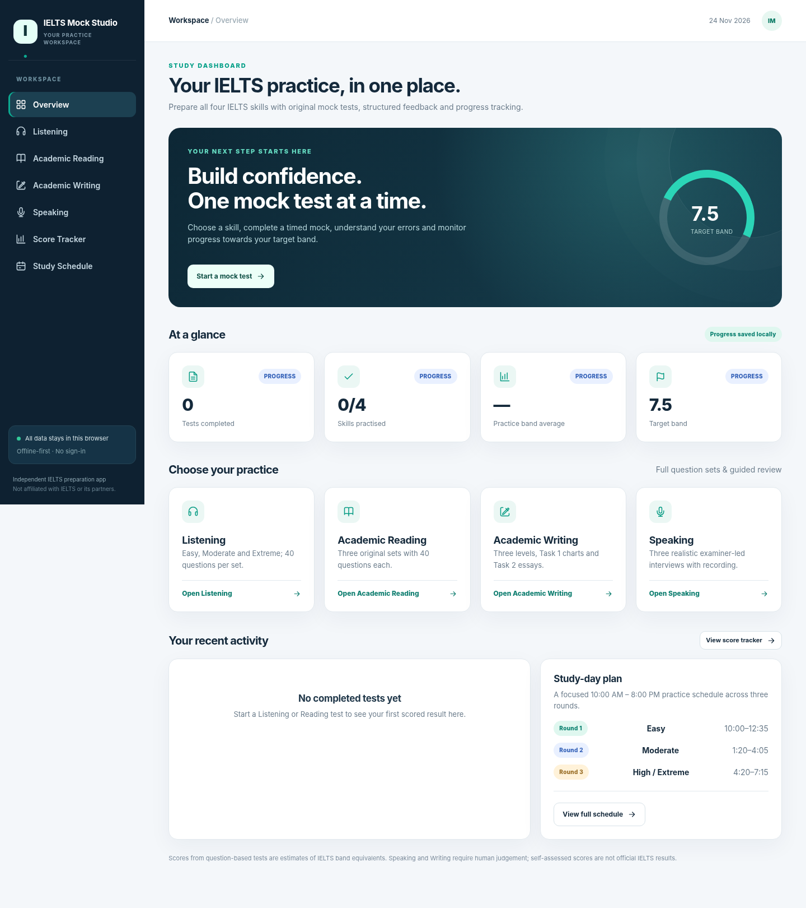

# IELTS Mock Studio

An original, offline-first **Academic IELTS practice web app** with **Listening, Reading, Writing, Speaking and a shared Score Tracker**. No account, database, paid API, Node installation or web server is required for the core features.



> **Independent practice project:** Not affiliated with or endorsed by IELTS, IDP, the British Council, or Cambridge. The practice questions are original. Band conversions are illustrative, and no algorithm here replaces a certified examiner.

## Features

| Module | What you can do | Scoring |
| --- | --- | --- |
| Listening | Easy, Moderate and Extreme; four sections and 40 questions per set. Interactive transcripts, speed and voice selection. | Mark answers and estimate band from 0–40 |
| Academic Reading | Three original graded tests, three passages and **40 questions each**. Short answer, TRUE/FALSE/NOT GIVEN and multiple choice. | Mark answers and estimate Academic Reading band |
| Academic Writing | Three difficulty levels, original Task 1 visuals, Task 2 prompts, typing area, automatic draft saving, 60-minute timer and word counter. | User/teacher enters IELTS criterion ratings; Task 2 counts twice |
| Speaking | Three examiner-style sets, Parts 1–3, optional browser voice questions, cue-card timing, microphone recording and file download. | User/teacher enters 4 criterion ratings; equal weighting |
| Score Tracker | Latest estimated bands, attempt history, chart, notes, goal, CSV export, JSON backup/import. | Practice-only overview, clearly distinguished from official IELTS results |
| Study Schedule | 10 AM to 8 PM three-round practice planner with checkable activities. | Locally saved checklist |

## Quick start

**Simplest:** Extract the ZIP and open `index.html` in Chrome or Microsoft Edge. On Windows, you can also double-click **`start-ielts.bat`** if Python is installed; that opens a local server for better microphone support. The site is a static HTML/CSS/JavaScript application and works offline after download.

**Recommended for microphone access and consistent browser support:**

```bash
cd IELTS-Mock-Studio
python -m http.server 8000
```

Then visit **http://localhost:8000**. `python` can be `py` on some Windows installations.

For local development, edit `assets/css/styles.css` and `assets/js/app.js`; the test data is in `assets/js/data.js`. No dependencies or build process are needed.

## Project structure

```text
IELTS-Mock-Studio/
├── index.html
├── assets/
│   ├── css/styles.css
│   ├── js/app.js          # SPA navigation, tests, TTS, recording, storage
│   ├── js/scoring.js      # Approximate band conversion and weighting
│   ├── js/data.js         # Original question banks
│   ├── audio/             # Four clearer Extreme Listening MP3s
│   └── favicon.svg
├── tests/scoring.test.cjs
├── .github/workflows/pages.yml
├── start-ielts.bat
├── publish-to-github.bat
├── LICENSE
└── README.md
```

## GitHub upload

1. In GitHub, create a **new empty public repository** named `IELTS-Mock-Studio`. Do **not** initialise it with a README, `.gitignore`, or licence.
2. Extract the download, open the `IELTS-Mock-Studio` folder, and double-click **`publish-to-github.bat`** on Windows. It uses `git` to create and push the project to `https://github.com/RUPEN-18/IELTS-Mock-Studio`.
3. Git may open a browser window for Git Credential Manager sign-in. Complete authentication with your GitHub account. Do not paste tokens into files.
4. To host the app, open the repository **Settings → Pages → Build and deployment → GitHub Actions**, then check the Actions deployment and published Pages link.

If you prefer a terminal, run:

```bash
git init
git add .
git commit -m "Initial IELTS Mock Studio release"
git branch -M main
git remote add origin https://github.com/RUPEN-18/IELTS-Mock-Studio.git
git push -u origin main
```

You need to install Git for Windows if `git` is not recognised. The publishing script does not create the repository; it pushes to the empty repository you create in GitHub.

## Assessment limitations

- **Listening and Reading:** 1 mark per correct answer. Published bands can vary slightly between test versions; the conversion is an approximation. Reading passages here are **condensed** compared with official full-length IELTS Reading material.
- **Writing:** The browser does not reliably judge content quality, grammatical nuance, or task achievement. Your provisional score comes from the four **entered** criterion ratings on each task, with Task 2 weighted twice. The 150/250-word requirements are visible; minimum word count alone does not establish a score.
- **Speaking:** Browser-generated voices are not human examiners and don't adapt to your answers. Recording is local and optional. An automated pronunciation score is not provided. A provisional Speaking band requires four **entered** assessment ratings.
- **Overall:** The tracker may show an indicative four-skill aggregate when available, but this is **not** an official IELTS overall band.
- **Data storage:** `localStorage` is confined to the browser/device. Clearing site data or using a different browser can erase it. Use the JSON backup export.
- **Audio & privacy:** No recording is uploaded to a server by the application. Microphone access may require HTTPS or `localhost`; `file://` support varies by browser. Offline MP3s use synthetic speech; available browser voices may sound more natural.

## Testing

```bash
node --test tests/*.test.cjs
```

The tests use Node's built-in test runner (no packages required). The application itself has no Node requirement.

## References

- [Official IELTS scoring in detail](https://ielts.org/take-a-test/your-results/ielts-scoring-in-detail)
- [Academic Reading format](https://ielts.org/take-a-test/test-types/ielts-academic-test/ielts-academic-format-reading)
- [Academic Writing format](https://ielts.org/take-a-test/test-types/ielts-academic-test/ielts-academic-format-writing)
- [Academic Speaking format](https://ielts.org/take-a-test/test-types/ielts-academic-test/ielts-academic-format-speaking)

## License

MIT for the project code and original practice content. Third-party trademarks belong to their owners.
